# 📱 Guia de Chamadas e Integração: `gateway_client.js`

Este documento explica **como o fluxo de chamadas funciona**, onde o código deve rodar e traz o **catálogo completo com exemplos práticos de todas as chamadas** disponíveis no cliente `gateway_client.js`.

---

## 🧭 1. Entendendo o Fluxo: Onde roda cada componente?

Quando um aluno acessa o aplicativo no celular ou um administrador usa o painel web, **o celular/navegador NÃO se conecta diretamente à blockchain nem guarda a chave mestra**. 

O fluxo seguro e recomendado funciona assim:

```mermaid
graph LR
    subgraph Cliente["Dispositivo do Usuário"]
        App["Celular / App Mobile / Frontend Web"]
    end

    subgraph Backend["Seu Servidor Backend (Node.js)"]
        API["Sua API Express / Rotas do Sistema"]
        SDK["gateway_client.js (SDK Cliente)"]
    end

    subgraph Nuvem["Oracle Cloud - VM 4 (129.146.55.236)"]
        GW["Gateway API RPC (Porta 8546)<br/>Autenticação X-API-KEY"]
        Besu["Nó Besu RPC (Porta 8545)"]
    end

    subgraph Rede["Cluster Multi-Node"]
        QBFT["Validadores QBFT (VM 1, VM 2, VM 3)"]
    end

    App -->|"1. Requisicao HTTP (/api/meu-saldo)"| API
    API -->|"2. client.getSaldo(carteira)"| SDK
    SDK -->|"3. HTTP POST/GET + X-API-KEY"| GW
    GW -->|"4. JSON-RPC (127.0.0.1:8545)"| Besu
    Besu -->|"5. Consenso On-Chain"| QBFT
    QBFT -->|"6. Confirmação do Bloco"| Besu
    Besu -->|"7. Resposta do Bloco"| GW
    GW -->|"8. JSON Tratado"| SDK
    SDK -->|"9. Objeto JavaScript"| API
    API -->|"10. Resposta Final JSON"| App
```



### Por que esse desenho é seguro e prático?
1. **Segurança do Token:** O token `X-API-KEY` dá permissão para cunhar moedas (`mint`) e gerenciar resgates. Se ficasse salvo dentro do aplicativo do celular, qualquer usuário malicioso poderia extrair o token do APK e gerar moedas infinitas. Ficando no seu Backend, a segurança é total.
2. **Zero Complexidade de Web3 no App:** O aplicativo móvel ou frontend não precisa carregar bibliotecas pesadas de blockchain (`ethers`, `web3.js`), nem converter unidades decimais (*Wei*), nem assinar transações de gas.
3. **Simplicidade Absoluta:** O seu backend apenas chama uma função como `client.getSaldo("0x...")` e recebe `{ saldo: 60, unidade: "WC" }`.

---

## 🚀 2. Como Rodar o Cliente Localmente para Testar

O arquivo `gateway_client.js` possui um teste completo embutido que você pode rodar do terminal da sua máquina agora mesmo:

```bash
cd /home/mikael/Documentos/Codes/facicoin/contratos
node gateway_client.js
```

Ao executar esse comando, o script na sua máquina:
1. Faz a conexão segura via internet até a VM 4 da Oracle Cloud (`129.146.55.236:8546`).
2. Verifica o status da blockchain e o número do bloco atual.
3. Consulta o saldo da carteira de teste.
4. Emite 10 WydenCoins on-chain para o aluno.
5. Confirma o novo saldo atualizado.

---

## 📦 3. Como Importar o Cliente no seu Projeto Backend

No projeto da sua API Backend (Express, Fastify, Nest.js, etc.):

1. Copie o arquivo [`gateway_client.js`](gateway_client.js) para uma pasta de serviços (ex: `src/services/gateway_client.js`).
2. Adicione as variáveis de ambiente no seu arquivo `.env` (opcional, já há valores padrão funcionais):

```env
BLOCKCHAIN_GATEWAY_URL=http://129.146.55.236:8546
BLOCKCHAIN_GATEWAY_TOKEN=wyden-rpc-sec-9a8f27b4e1
```

3. No seu controller ou serviço Node.js, importe e instancie a classe:

```javascript
// Importacao CommonJS
const { WydencoinGatewayClient } = require('./services/gateway_client');

// Cria a instancia do cliente
const blockchain = new WydencoinGatewayClient();
```

---

## 📚 4. Catálogo Completo de Chamadas

Abaixo estão todas as funções disponíveis no `gateway_client.js`, seus parâmetros, retornos e exemplos de como utilizá-las dentro de rotas Express.

---

### 1️⃣ Verificar Saúde da Blockchain (`getHealth`)

Verifica se o nó Besu da nuvem está sincronizado, o número do bloco atual e os endereços dos contratos ativos.

* **Parâmetros:** Nenhum.
* **Autenticação:** Rota pública (não consome token).

```javascript
// Exemplo de chamada:
const saude = await blockchain.getHealth();

console.log(saude);
```

**Exemplo de Resposta:**
```json
{
  "status": "UP",
  "network": {
    "chainId": 1337,
    "blockNumber": 92600,
    "peers": 2,
    "syncing": false
  },
  "contracts": {
    "wydenCoin": "0xa50a51c09a5c451C52BB714527E1974b686D8e77",
    "redemptionManager": "0x9a3DBCa554e9f6b9257aAa24010DA8377C57c17e"
  },
  "timestamp": "2026-11-17T14:00:00.000Z"
}
```

---

### 2️⃣ Consultar Saldo de um Aluno (`getSaldo`)

Consulta quantas WydenCoins o aluno possui na carteira. É uma leitura imediata sem custo de gas.

* **Parâmetros:**
  * `alunoAddress` *(string, obrigatório)*: Endereço público hexadecimal da carteira (ex: `0xFE3B55...`).

```javascript
// Exemplo em uma rota Express:
app.get('/api/alunos/:endereco/saldo', async (req, res) => {
  try {
    const resultado = await blockchain.getSaldo(req.params.endereco);
    return res.json({
      carteira: resultado.aluno,
      saldo: resultado.saldo,
      moeda: resultado.unidade // "WC"
    });
  } catch (erro) {
    return res.status(500).json({ erro: erro.message });
  }
});
```

**Exemplo de Resposta:**
```json
{
  "success": true,
  "aluno": "0xFE3B557E8Fb62b89F4916B721be55cEb828dBd73",
  "saldo": 60,
  "unidade": "WC"
}
```

---

### 3️⃣ Emitir Recompensa Individual (`emitirRecompensa`)

Emite moedas (mint) para um aluno quando ele cumpre uma atividade acadêmica ou mérito.

* **Parâmetros:**
  * `alunoAddress` *(string, obrigatório)*: Carteira do aluno que vai receber.
  * `valor` *(number, obrigatório)*: Quantidade inteira de WydenCoins a creditar.
  * `motivo` *(string, opcional)*: Código da regra pedagógica (ver tabela de motivos na Seção 5).

```javascript
// Exemplo: Bonificar aluno que fez o Simulado (30 WC)
app.post('/api/recompensas/simulado', async (req, res) => {
  try {
    const { carteiraAluno } = req.body;
    
    const transacao = await blockchain.emitirRecompensa(
      carteiraAluno, 
      30, 
      "SIMULADO"
    );

    return res.json({
      mensagem: "Recompensa creditada com sucesso na blockchain!",
      txHash: transacao.txHash,
      bloco: transacao.blockNumber
    });
  } catch (erro) {
    return res.status(500).json({ erro: erro.message });
  }
});
```

**Exemplo de Resposta:**
```json
{
  "success": true,
  "txHash": "0x78a4b6c...91b2",
  "blockNumber": 92605,
  "aluno": "0xFE3B557E8Fb62b89F4916B721be55cEb828dBd73",
  "valor": 30,
  "motivo": "SIMULADO"
}
```

---

### 4️⃣ Emissão em Lote Quinzenal (`emitirLoteRecompensas`)

Processa múltiplas bonificações de uma só vez em uma única transação atômica. Ideal para fechamento quinzenal automatizado de frequência e acessos ao portal.

* **Parâmetros:**
  * `itens` *(array de objetos, obrigatório)*: Lista com `{ aluno, valor, motivo }`.

```javascript
// Exemplo: Rotina Cron de fechamento quinzenal
const premiacoes = [
  { aluno: "0xFE3B557E8Fb62b89F4916B721be55cEb828dBd73", valor: 10, motivo: "SIA_15D" },
  { aluno: "0x70997970C51812dc3A010C7d01b50e0d17dc79C8", valor: 10, motivo: "PRES_15D" },
  { aluno: "0x3C44CdDdB6a900fa2b585dd299e03d12FA4293BC", valor: 30, motivo: "SIMULADO" }
];

const resultadoLote = await blockchain.emitirLoteRecompensas(premiacoes);
console.log(`Lote processado! ${resultadoLote.totalItens} premiações incluídas.`);
console.log(`TxHash da transação única: ${resultadoLote.txHash}`);
```

**Exemplo de Resposta:**
```json
{
  "success": true,
  "totalItens": 3,
  "txHash": "0x12c4e5...89aa",
  "blockNumber": 92610
}
```

---

### 5️⃣ Solicitar Resgate de Benefício (`solicitarResgate`)

Inicia o ciclo de compra de um voucher na cantina ou agendamento de mentoria. Os tokens do aluno são transferidos para custódia temporária do contrato `RedemptionManager`.

* **Parâmetros:**
  * `alunoPrivateKey` *(string, obrigatório)*: Chave privada da carteira do aluno (para autorizar a retenção das moedas).
  * `beneficioId` *(number, obrigatório)*: ID numérico do benefício no banco de dados.
  * `valor` *(number, obrigatório)*: Custo do item em WydenCoins.
  * `horasValidade` *(number, opcional, padrão: 24)*: Prazo para expiração do voucher em horas.

```javascript
// Exemplo: Aluno resgata um "Café com Pão de Queijo" (15 WC)
const resgate = await blockchain.solicitarResgate(
  alunoPrivateKey, // Chave privada segura do aluno
  101,             // ID do produto no banco (ex: Cafe Cantina)
  15,              // 15 WC
  48               // Validade de 48 horas
);

console.log(`Resgate criado com ID #${resgate.idResgate}`);
console.log(`Expira no timestamp Unix: ${resgate.expiraEm}`);
```

**Exemplo de Resposta:**
```json
{
  "success": true,
  "idResgate": 1,
  "beneficioId": 101,
  "valor": 15,
  "expiraEm": 1763481600,
  "txHash": "0xabc...def"
}
```

---

### 6️⃣ Consultar Detalhes de um Resgate (`consultarResgate`)

Consulta o status on-chain de um voucher emitido.

* **Parâmetros:**
  * `id` *(number, obrigatório)*: ID do resgate gerado on-chain.

```javascript
const voucher = await blockchain.consultarResgate(1);

console.log("Status:", voucher.status); 
// Retorna: "Resgatado" (pendente), "Utilizado", "Cancelado" ou "Expirado"
```

**Exemplo de Resposta:**
```json
{
  "success": true,
  "id": 1,
  "aluno": "0xFE3B557E8Fb62b89F4916B721be55cEb828dBd73",
  "beneficioId": 101,
  "valor": 15,
  "expiraEm": 1763481600,
  "status": "Resgatado",
  "statusCode": 0
}
```

---

### 7️⃣ Confirmar Uso do Voucher na Cantina (`confirmarUsoVoucher`)

Chamado quando o operador da cantina ou mentor valida o QR Code do voucher presencialmente. Queima permanentemente as moedas retidas na custódia.

* **Parâmetros:**
  * `id` *(number, obrigatório)*: ID do resgate.

```javascript
// Exemplo: Operador da cantina escaneia o QR Code do voucher ID 1
app.post('/api/cantina/validar-voucher/:id', async (req, res) => {
  try {
    const confirmacao = await blockchain.confirmarUsoVoucher(req.params.id);
    return res.json({
      sucesso: true,
      mensagem: "Voucher validado e tokens queimados com sucesso!",
      txHash: confirmacao.txHash
    });
  } catch (erro) {
    return res.status(400).json({ erro: erro.message });
  }
});
```

**Exemplo de Resposta:**
```json
{
  "success": true,
  "id": 1,
  "status": "Utilizado",
  "txHash": "0xdef...123",
  "blockNumber": 92615
}
```

---

### 8️⃣ Cancelar Voucher e Reembolsar (`cancelarVoucher`)

Cancela um voucher pendente por solicitação do aluno ou gestor. Devolve integralmente o saldo de moedas para o aluno.

* **Parâmetros:**
  * `id` *(number, obrigatório)*: ID do resgate.

```javascript
const cancelamento = await blockchain.cancelarVoucher(1);
console.log(`Voucher cancelado e saldo devolvido ao aluno.`);
```

**Exemplo de Resposta:**
```json
{
  "success": true,
  "id": 1,
  "status": "Cancelado",
  "txHash": "0x456...789",
  "blockNumber": 92620
}
```

---

### 9️⃣ Expirar Voucher Vencido (`expirarVoucher`)

Quando o prazo do voucher é ultrapassado sem utilização, essa função processa a devolução automática das moedas para a conta do aluno.

* **Parâmetros:**
  * `id` *(number, obrigatório)*: ID do resgate vencido.

```javascript
const expirado = await blockchain.expirarVoucher(1);
console.log(`Voucher expirado e moedas devolvidas.`);
```

---

### 🔟 Chamada RPC Bruta Avançada (`chamadaRpcBruta`)

Permite executar qualquer chamada padrão da API Ethereum JSON-RPC diretamente através da conexão segura do gateway, sem expor o Besu diretamente.

* **Parâmetros:**
  * `method` *(string, obrigatório)*: Nome do método RPC (ex: `eth_blockNumber`, `eth_getTransactionReceipt`).
  * `params` *(array, opcional)*: Parâmetros da chamada RPC.

```javascript
// Exemplo: Obter o número do bloco mais recente em hexadecimal
const rpc = await blockchain.chamadaRpcBruta("eth_blockNumber", []);
console.log("Bloco em decimal:", parseInt(rpc.result, 16));
```

---

## 🏷️ 5. Tabela de Motivos Padrão (WydenCoin)

Use estas strings padronizadas no parâmetro `motivo` da emissão de moedas:

| Código Motivo | Valor Típico | Descrição Regra de Negócio |
| :--- | :---: | :--- |
| `SIA_15D` | 10 WC | Aluno acessou o portal acadêmico (SIA) ao menos 1 vez na quinzena |
| `PRES_15D` | 10 WC | Aluno manteve frequência regular (>=75%) no período quinzenal |
| `SIMULADO` | 30 WC | Participação e entrega do simulado semestral |
| `DIG_ESTUDO`| 10 WC | Conclusão de módulo ou trilha de estudo digital |
| `VOLTOU` | 20 WC | Reengajamento / Rematrícula confirmada |
| `CR_SEM` | 40 WC | Aluno de destaque por Coeficiente de Rendimento no semestre |

---

## 🛡️ 6. Tratamento de Erros e Boas Práticas

Todas as funções do `gateway_client.js` lançam erros padrão do JavaScript caso ocorra algum problema (falha de rede, chave de API inválida, saldo insuficiente ou parâmetros ausentes).

Sempre envolva as chamadas em blocos `try/catch`:

```javascript
try {
  const resultado = await blockchain.emitirRecompensa(carteira, 10, "PRES_15D");
  console.log("Sucesso:", resultado.txHash);
} catch (erro) {
  // erro.message contem a explicacao detalhada devolvida pelo Gateway
  console.error("Falha ao comunicar com a Blockchain:", erro.message);
}
```

### Principais códigos de erro e soluções:
* **`Token de autenticação ausente ou inválido`**: Verifique se o `API_KEY` (`wyden-rpc-sec-9a8f27b4e1`) está configurado no cabeçalho `X-API-KEY`.
* **`Saldo insuficiente para realizar resgate`**: O aluno tentou resgatar um item com valor superior ao seu saldo de WC.
* **`Voucher expirado ou já utilizado`**: Tentativa de confirmar ou cancelar um voucher fora do estado pendente.
* **`Erro HTTP 403: Forbidden (FortiGuard / Firewall de Rede)`**: Se você estiver conectado na rede Wi-Fi corporativa ou da faculdade, o firewall (Fortinet/FortiGuard) pode bloquear requisições HTTP para IPs públicos não catalogados. 
  * *Solução rápida no desenvolvimento local:* Crie um túnel SSH seguro executando no terminal:
    ```bash
    ssh -f -N -L 8546:127.0.0.1:8546 ubuntu@129.146.55.236
    ```
    E aponte a URL no `.env` para:
    ```env
    BLOCKCHAIN_GATEWAY_URL=http://localhost:8546
    ```
  * *Em produção:* Servidores em nuvem (Render, AWS, Heroku, Supabase Edge Functions) ou redes 4G/5G não sofrem esse bloqueio e acessam `http://129.146.55.236:8546` diretamente.

---

## 🏁 Resumo

* **No Celular/Frontend:** Apenas faça chamadas HTTP normais para o seu backend (ex: `GET /api/meu-saldo`).
* **No seu Backend:** Use o `gateway_client.js` para consultar e transacionar na blockchain.
* **Na VM 4 Cloud:** O Gateway gerencia a autenticação, segurança, taxas de gas e fala diretamente com os nós Besu.
