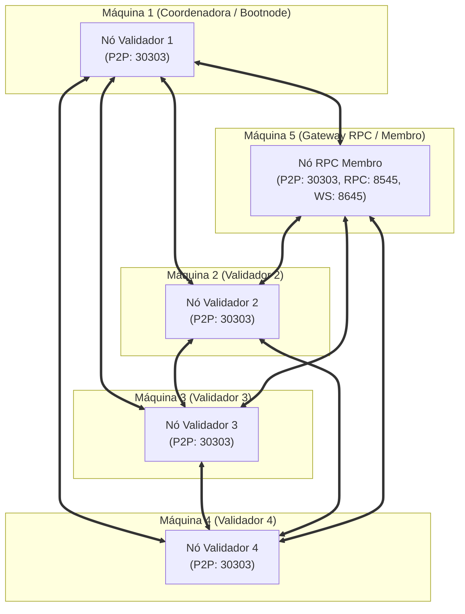

# Arquitetura da Rede Hyperledger Besu Multi-Node (WydenCoin)

Este documento detalha o desenho de arquitetura de rede distribuída entre múltiplas máquinas físicas ou virtuais distintas, inspirado nas melhores práticas desenvolvidas pelo projeto **Ilíada (RNP)** no repositório `cenarios-bevel`.

---

## 1. Topologia da Rede

A rede é baseada no algoritmo de consenso **QBFT (Quorum Byzantine Fault Tolerance)** configurado para 4 nós validadores com tolerância a até 1 nó faltoso ou malicioso ($F = \lfloor (N - 1) / 3 \rfloor = 1$ quando $N = 4$).

---

## 2. Papéis dos Nós (Roles)

### A. Máquina Coordenadora / Bootnode (Nó 1)
* **Papel:** Ponto de ancoragem para descoberta P2P e Validador inicial da rede.
* **Geração Criptográfica:** É a máquina que executa a geração do bloco gênese (`genesis.json`), chaves dos validadores e allowlists.
* **Empacotamento:** Cria os pacotes de distribuição (`dist/*.tar.gz`) que serão transferidos para as outras máquinas via `scp`.
* **Portas Abertas:** `30303` TCP/UDP (P2P Discovery).

### B. Máquinas Validadoras (Nós 2, 3 e 4)
* **Papel:** Participantes do comitê de validação do consenso QBFT.
* **Execução:** Assinam e propõem blocos a cada 2 segundos.
* **Segurança:** As portas JSON-RPC HTTP (`8545`) e WS (`8645`) ficam **fechadas/desabilitadas** nesses nós por padrão, protegendo a chave privada do validador contra ataques externos.
* **Portas Abertas:** `30303` TCP/UDP (P2P).

### C. Máquina Gateway / RPC (Nó Membro)
* **Papel:** Ponto de entrada e saída de dados para o mundo externo (API Node.js, Caliper, MetaMask, Blockscout).
* **Execução:** Não possui chave de validador (não assina blocos, apenas replica o estado da cadeia).
* **Portas Abertas:**
  * `30303` TCP/UDP (P2P);
  * `8545` TCP (JSON-RPC HTTP com CORS aberto `*` e APIs `ETH,NET,WEB3,QBFT,DEBUG`);
  * `8645` TCP (WebSockets para escuta de eventos `RewardMinted` e `ResgateCriado`);
  * `9545` TCP (Métricas Prometheus, opcional).

---

## 3. Segurança e Firewall

Para garantir a comunicação entre as máquinas em uma rede corporativa/laboratorial:

| Porta | Protocolo | Origem | Destino | Finalidade |
|:------|:----------|:-------|:--------|:-----------|
| `30303` | TCP / UDP | Qualquer nó da rede | Todas as máquinas | Descoberta e sincronização P2P do Besu |
| `8545` | TCP | Backend / JMeter / Devs | Máquina RPC | Envio de transações e consultas Web3 |
| `8645` | TCP | Backend / Indexador | Máquina RPC | Assinatura de WebSockets para eventos |
| `9545` | TCP | Servidor Prometheus | Máquina RPC | Coleta de telemetria |
