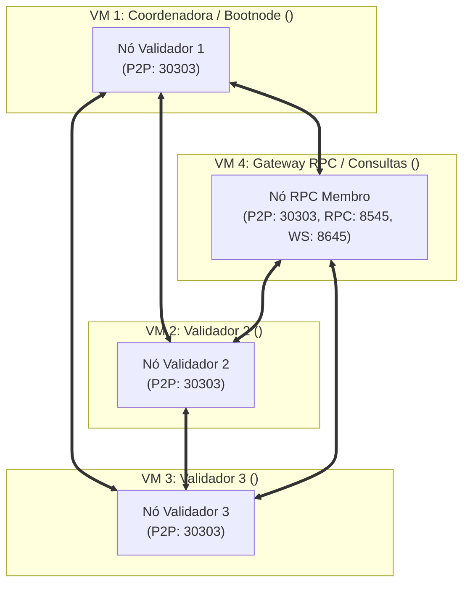

# Arquitetura da Rede Hyperledger Besu Multi-Node (WydenCoin)

Este documento detalha o desenho de arquitetura de rede distribuída entre **4 máquinas virtuais (VMs)** distintas.

---

## 1. Topologia da Rede (4 VMs)

A rede é baseada no algoritmo de consenso **QBFT (Quorum Byzantine Fault Tolerance)** com **3 nós validadores** e **1 nó de gateway/RPC** para consultas, API e integração de aplicações externas:

---

## 2. Papéis dos Nós (Roles)

### A. VM 1: Coordenadora / Bootnode (Validador 1)
* **Papel:** Ponto de ancoragem para descoberta P2P e Validador inicial da rede.
* **Geração Criptográfica:** É a máquina que executa a geração do bloco gênese (`genesis.json`), chaves dos validadores e allowlists.
* **Empacotamento:** Cria os pacotes de distribuição (`dist/*.tar.gz`) que serão transferidos para as outras máquinas via `scp`.
* **Portas Abertas:** `30303` TCP/UDP (P2P Discovery).

### B. VMs 2 e 3: Máquinas Validadoras (Validadores 2 e 3)
* **Papel:** Participantes do comitê de validação do consenso QBFT.
* **Execução:** Assinam e propõem blocos a cada 2 segundos.
* **Segurança:** As portas JSON-RPC externas ficam desabilitadas nesses nós por padrão, protegendo a chave privada do validador contra acessos indevidos.
* **Portas Abertas:** `30303` TCP/UDP (P2P).

### C. VM 4: Máquina Gateway / RPC (Consultas e Transações)
* **Papel:** Ponto de entrada e saída de dados para o mundo externo (APIs backend, MetaMask, ferramentas de teste de carga e benchmark).
* **Execução:** Não possui chave de validador (não assina blocos, apenas replica o estado da cadeia).
* **Portas Abertas:**
  * `30303` TCP/UDP (P2P);
  * `8545` TCP (JSON-RPC HTTP com CORS aberto `*` e APIs `ETH,NET,WEB3,QBFT,DEBUG,TXPOOL`);
  * `8645` TCP (WebSockets para escuta de eventos `RewardMinted` e `ResgateCriado`);
  * `9545` TCP (Métricas Prometheus, opcional).

---

## 3. Segurança e Firewall

Para garantir a comunicação entre as máquinas em uma rede corporativa/laboratorial:

| Porta | Protocolo | Origem | Destino | Finalidade |
|:------|:----------|:-------|:--------|:-----------|
| `30303` | TCP / UDP | Qualquer nó da rede | Todas as máquinas | Descoberta e sincronização P2P do Besu |
| `8545` | TCP | Aplicações clientes / Devs | Máquina RPC | Envio de transações e consultas Web3 |
| `8645` | TCP | Backend / Indexador | Máquina RPC | Assinatura de WebSockets para eventos |
| `9545` | TCP | Servidor Prometheus | Máquina RPC | Coleta de telemetria |
