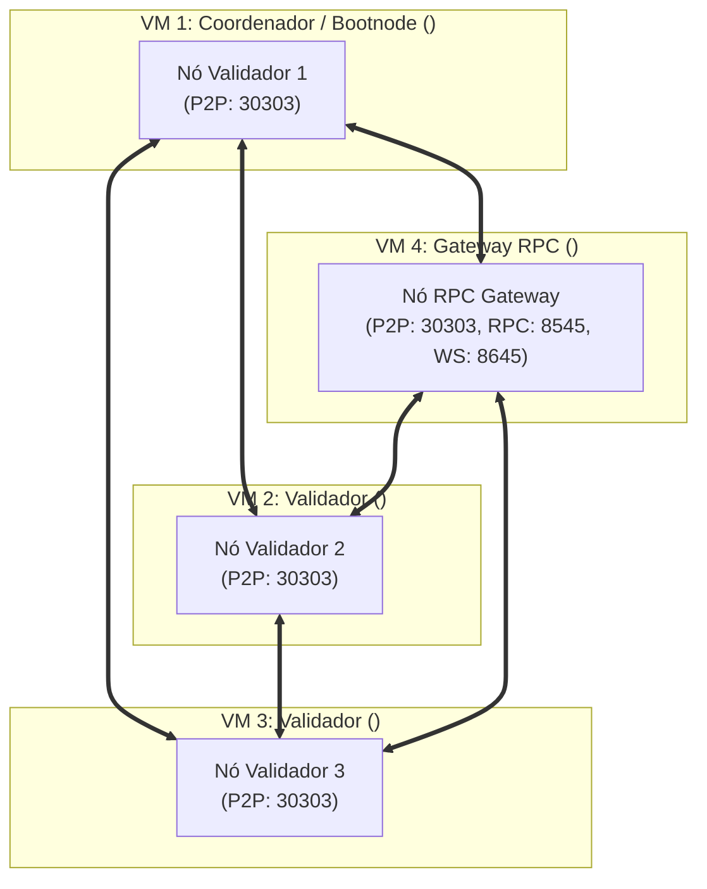

# Laboratório Hyperledger Besu QBFT: Instalação Manual em Múltiplas Máquinas (lab-multi-node)

> [!NOTE]
> Este guia descreve o procedimento operacional de instalação, configuração e implantação da rede privada Hyperledger Besu (QBFT) em **4 máquinas virtuais (VMs) independentes** de forma **puramente manual**, detalhando cada comando Docker, arquivo de configuração e transferência entre servidores **sem o uso de scripts automáticos (`.sh`)**.

> [!TIP]
> **Substituição Rápida com Ctrl + F:**
> Este documento utiliza placeholders padronizados para facilitar a configuração do seu ambiente. Utilize o comando de busca e substituição do seu editor para preenchê-los com os valores reais da sua infraestrutura:
> - `<node1-ip>` : Endereço IP da **VM 1** (Coordenadora / Bootnode + Validador 1)
> - `<node2-ip>` : Endereço IP da **VM 2** (Validador 2)
> - `<node3-ip>` : Endereço IP da **VM 3** (Validador 3)
> - `<rpc-ip>` : Endereço IP da **VM 4** (Gateway RPC / Consultas e Aplicações Externas)
> - `<usuario>` : Nome do usuário SSH com permissão de sudo/docker nas máquinas

---

## 1. Topologia da Rede Distribuída (4 VMs)

A arquitetura distribui o algoritmo de consenso bizantino **QBFT** entre 3 nós validadores e isola o acesso externo em um gateway RPC dedicado:

| Máquina | Papel na Rede | Host / IP | Portas Expostas | Finalidade |
| :--- | :--- | :--- | :--- | :--- |
| **VM 1** | **Coordenador + Validador 1 (Bootnode)** | `<node1-ip>` | `30303` (P2P), `8545` (RPC Local) | Descoberta P2P e proposta/assinatura de blocos |
| **VM 2** | **Validador 2** | `<node2-ip>` | `30303` (P2P), `8545` (RPC Local) | Assinatura e consenso QBFT |
| **VM 3** | **Validador 3** | `<node3-ip>` | `30303` (P2P), `8545` (RPC Local) | Assinatura e consenso QBFT |
| **VM 4** | **Gateway RPC / Membro** | `<rpc-ip>` | `30303` (P2P), `8545` (HTTP Público), `8645` (WS) | Interface Web3 para DApps, MetaMask e ferramentas de benchmark de carga |



---

## 2. Pré-requisitos e Firewall em Todas as VMs

Em **todas as 4 máquinas**, certifique-se de que o Docker está instalado e o usuário possui acesso ao grupo `docker`:

```bash
docker --version
```

### Regras de Firewall (UFW / iptables)
* **Em todas as 4 VMs (Comunicação P2P Discovery e Sincronização)**:
  ```bash
  sudo ufw allow 30303/tcp
  sudo ufw allow 30303/udp
  ```
* **Apenas na VM 4 (Gateway de API RPC e WebSockets)**:
  ```bash
  sudo ufw allow 8545/tcp
  sudo ufw allow 8645/tcp
  ```

---

## 3. VM 1: Geração Criptográfica e Inicialização do Bootnode

A **VM 1** atuará como máquina coordenadora. Nela serão geradas as chaves criptográficas de todos os nós, o arquivo de gênese (`genesis.json`) e as listas de permissões.

Acesse a **VM 1**:
```bash
ssh <usuario>@<node1-ip>
```

### 3.1. Criar Diretórios de Trabalho na VM 1
```bash
mkdir -p ~/besu-network/{config,node1/data,node2/data,node3/data,rpcnode/data}
cd ~/besu-network
```

### 3.2. Criar Template do Bloco Gênese QBFT
Crie o arquivo `config/genesis_QBFT.json`:

```bash
cat <<'EOF' > config/genesis_QBFT.json
{
  "genesis": {
    "config": {
      "chainId": 381660001,
      "muirglacierblock": 0,
      "londonBlock": 0,
      "zeroBaseFee": true,
      "qbft": {
        "blockperiodseconds": 2,
        "epochlength": 30000,
        "requesttimeoutseconds": 4
      }
    },
    "nonce": "0x0",
    "timestamp": "0x58ee40ba",
    "gasLimit": "0x1fffffffffffff",
    "difficulty": "0x1",
    "mixHash": "0x63746963616c2062797a616e74696e65206661756c7420746f6c6572616e6365",
    "coinbase": "0x0000000000000000000000000000000000000000",
    "alloc": {
      "fe3b557e8fb62b89f4916b721be55ceb828dbd73": {
        "balance": "0xad78ebc5ac6200000"
      },
      "627306090abaB3A6e1400e9345bC60c78a8BEf57": {
        "balance": "90000000000000000000000"
      },
      "f17f52151EbEF6C7334FAD080c5704D77216b732": {
        "balance": "90000000000000000000000"
      }
    }
  },
  "blockchain": {
    "nodes": {
      "generate": true,
      "count": 3
    }
  }
}
EOF
```

### 3.3. Gerar Chaves e genesis.json via Contêiner Besu
```bash
docker run --rm \
  -u "$(id -u):$(id -g)" \
  -v $(pwd)/config:/data \
  hyperledger/besu:24.7.0 \
  operator generate-blockchain-config \
  --config-file=/data/genesis_QBFT.json \
  --to=/data/networkFiles \
  --private-key-file-name=key
```

### 3.4. Distribuir as Chaves para as Pastas de Cada Nó
```bash
KEYS=($(ls -d config/networkFiles/keys/0x* | sort))

# Nó 1 (VM 1)
cp "${KEYS[0]}/key" node1/data/key
cp "${KEYS[0]}/key.pub" node1/data/key.pub

# Nó 2 (Para enviar à VM 2)
cp "${KEYS[1]}/key" node2/data/key
cp "${KEYS[1]}/key.pub" node2/data/key.pub

# Nó 3 (Para enviar à VM 3)
cp "${KEYS[2]}/key" node3/data/key
cp "${KEYS[2]}/key.pub" node3/data/key.pub

# Copia o genesis.json para todos os nós
cp config/networkFiles/genesis.json node1/genesis.json
cp config/networkFiles/genesis.json node2/genesis.json
cp config/networkFiles/genesis.json node3/genesis.json
cp config/networkFiles/genesis.json rpcnode/genesis.json
```

### 3.5. Calcular a Enode URL do Bootnode (Nó 1)
O Enode identifica o Nó 1 na rede mundial/local através de sua chave pública e do IP da **VM 1**:

```bash
PUBKEY_NODE1=$(cat node1/data/key.pub | sed 's/^0x//')
BOOTNODE_ENODE="enode://${PUBKEY_NODE1}@<node1-ip>:30303"

echo "Bootnode Enode Oficial: ${BOOTNODE_ENODE}"
```

> [!IMPORTANT]
> Copie o valor retornado em `BOOTNODE_ENODE`. Ele será usado diretamente nos comandos de inicialização das VMs 2, 3 e 4.

### 3.6. Criar Arquivo de Permissões (`permissions_config.toml`)
```bash
VAL1_ADDR=$(basename "${KEYS[0]}")
VAL2_ADDR=$(basename "${KEYS[1]}")
VAL3_ADDR=$(basename "${KEYS[2]}")

cat <<EOF > config/permissions_config.toml
accounts-allowlist=[
  "0xfe3b557e8fb62b89f4916b721be55ceb828dbd73",
  "${VAL1_ADDR}",
  "${VAL2_ADDR}",
  "${VAL3_ADDR}"
]
EOF

cp config/permissions_config.toml node1/permissions_config.toml
cp config/permissions_config.toml node2/permissions_config.toml
cp config/permissions_config.toml node3/permissions_config.toml
cp config/permissions_config.toml rpcnode/permissions_config.toml
```

### 3.7. Iniciar o Nó 1 na VM 1
Execute o contêiner do Validador 1:

```bash
docker run -d \
  --name besu-node1 \
  --restart unless-stopped \
  --network host \
  -v $(pwd)/node1/data:/opt/besu/data \
  -v $(pwd)/node1/genesis.json:/opt/besu/genesis.json \
  -v $(pwd)/node1/permissions_config.toml:/opt/besu/permissions_config.toml \
  hyperledger/besu:24.7.0 \
  --data-path=/opt/besu/data \
  --genesis-file=/opt/besu/genesis.json \
  --p2p-port=30303 \
  --p2p-host=<node1-ip> \
  --min-gas-price=0 \
  --data-storage-format=BONSAI \
  --profile=ENTERPRISE \
  --permissions-accounts-config-file=/opt/besu/permissions_config.toml \
  --permissions-accounts-config-file-enabled=true \
  --rpc-http-enabled=true \
  --rpc-http-host=127.0.0.1 \
  --rpc-http-port=8545 \
  --rpc-http-api=ETH,NET,WEB3,QBFT
```

Verifique se o Nó 1 está em execução:
```bash
docker ps --filter "name=besu-node1"
```

---

## 4. Distribuição Manual dos Arquivos para as VMs 2, 3 e 4 (`scp`)

Ainda na **VM 1**, transfira as pastas de configuração para cada uma das máquinas remotas:

```bash
# Enviar pasta node2 para a VM 2
scp -r ~/besu-network/node2 <usuario>@<node2-ip>:~/node2

# Enviar pasta node3 para a VM 3
scp -r ~/besu-network/node3 <usuario>@<node3-ip>:~/node3

# Enviar pasta rpcnode para a VM 4
scp -r ~/besu-network/rpcnode <usuario>@<rpc-ip>:~/rpcnode
```

---

## 5. VM 2: Inicialização Manual do Validador 2

Acesse a **VM 2**:
```bash
ssh <usuario>@<node2-ip>
cd ~/node2
```

Inicie o contêiner do Validador 2 informando a Enode URL do Bootnode (`<node1-ip>`):

```bash
docker run -d \
  --name besu-node2 \
  --restart unless-stopped \
  --network host \
  -v $(pwd)/data:/opt/besu/data \
  -v $(pwd)/genesis.json:/opt/besu/genesis.json \
  -v $(pwd)/permissions_config.toml:/opt/besu/permissions_config.toml \
  hyperledger/besu:24.7.0 \
  --data-path=/opt/besu/data \
  --genesis-file=/opt/besu/genesis.json \
  --p2p-port=30303 \
  --p2p-host=<node2-ip> \
  --bootnodes=enode://<node1-pubkey>@<node1-ip>:30303 \
  --min-gas-price=0 \
  --data-storage-format=BONSAI \
  --profile=ENTERPRISE \
  --permissions-accounts-config-file=/opt/besu/permissions_config.toml \
  --permissions-accounts-config-file-enabled=true \
  --rpc-http-enabled=true \
  --rpc-http-host=127.0.0.1 \
  --rpc-http-port=8545 \
  --rpc-http-api=ETH,NET,WEB3,QBFT
```

Verifique os logs de conexão P2P:
```bash
docker logs -f besu-node2
```

---

## 6. VM 3: Inicialização Manual do Validador 3

Acesse a **VM 3**:
```bash
ssh <usuario>@<node3-ip>
cd ~/node3
```

Inicie o contêiner do Validador 3:

```bash
docker run -d \
  --name besu-node3 \
  --restart unless-stopped \
  --network host \
  -v $(pwd)/data:/opt/besu/data \
  -v $(pwd)/genesis.json:/opt/besu/genesis.json \
  -v $(pwd)/permissions_config.toml:/opt/besu/permissions_config.toml \
  hyperledger/besu:24.7.0 \
  --data-path=/opt/besu/data \
  --genesis-file=/opt/besu/genesis.json \
  --p2p-port=30303 \
  --p2p-host=<node3-ip> \
  --bootnodes=enode://<node1-pubkey>@<node1-ip>:30303 \
  --min-gas-price=0 \
  --data-storage-format=BONSAI \
  --profile=ENTERPRISE \
  --permissions-accounts-config-file=/opt/besu/permissions_config.toml \
  --permissions-accounts-config-file-enabled=true \
  --rpc-http-enabled=true \
  --rpc-http-host=127.0.0.1 \
  --rpc-http-port=8545 \
  --rpc-http-api=ETH,NET,WEB3,QBFT
```

> [!NOTE]
> **Quorum QBFT Atingido:**
> Agora que os 3 validadores estão conectados, a rede possui o número de participantes necessário para atingir o consenso bizantino. Os nós começarão a gerar novos blocos a cada 2 segundos!

---

## 7. VM 4: Inicialização Manual do Gateway RPC

Acesse a **VM 4**:
```bash
ssh <usuario>@<rpc-ip>
cd ~/rpcnode
```

Inicie o nó de consulta (sem chaves de validador), expondo a interface RPC na porta `8545` e WebSockets na `8645`:

```bash
docker run -d \
  --name besu-rpcnode \
  --restart unless-stopped \
  --network host \
  -v $(pwd)/data:/opt/besu/data \
  -v $(pwd)/genesis.json:/opt/besu/genesis.json \
  -v $(pwd)/permissions_config.toml:/opt/besu/permissions_config.toml \
  hyperledger/besu:24.7.0 \
  --data-path=/opt/besu/data \
  --genesis-file=/opt/besu/genesis.json \
  --p2p-port=30303 \
  --p2p-host=<rpc-ip> \
  --bootnodes=enode://<node1-pubkey>@<node1-ip>:30303 \
  --min-gas-price=0 \
  --data-storage-format=BONSAI \
  --profile=ENTERPRISE \
  --permissions-accounts-config-file=/opt/besu/permissions_config.toml \
  --permissions-accounts-config-file-enabled=true \
  --rpc-http-enabled=true \
  --rpc-http-host=0.0.0.0 \
  --rpc-http-port=8545 \
  --rpc-http-api=ETH,NET,WEB3,QBFT,DEBUG,TXPOOL \
  --rpc-http-cors-origins="*" \
  --rpc-ws-enabled=true \
  --rpc-ws-host=0.0.0.0 \
  --rpc-ws-port=8645 \
  --rpc-ws-api=ETH,NET,WEB3,QBFT \
  --metrics-enabled=true \
  --metrics-port=9545
```

---

## 8. Verificação e Diagnóstico a partir de Qualquer Computador

A partir de qualquer máquina com acesso de rede à **VM 4**, você pode interagir com a blockchain:

### 8.1. Verificar se os Peers estão Conectados
```bash
curl -s -X POST --data '{"jsonrpc":"2.0","method":"net_peerCount","params":[],"id":1}' \
  -H "Content-Type: application/json" http://<rpc-ip>:8545
```
*Resposta esperada:* `{"jsonrpc":"2.0","id":1,"result":"0x3"}` (3 peers conectados).

### 8.2. Verificar a Produção Contínua de Blocos
```bash
curl -s -X POST --data '{"jsonrpc":"2.0","method":"eth_blockNumber","params":[],"id":1}' \
  -H "Content-Type: application/json" http://<rpc-ip>:8545
```
*Execute o comando duas vezes com intervalo de 2 a 4 segundos; o número do bloco em hexadecimal deve avançar continuamente.*

### 8.3. Consultar os Validadores QBFT
```bash
curl -s -X POST --data '{"jsonrpc":"2.0","method":"qbft_getValidatorsByBlockNumber","params":["latest"],"id":1}' \
  -H "Content-Type: application/json" http://<rpc-ip>:8545
```
*Retornará o array com os endereços dos validadores das VMs 1, 2 e 3.*

---

## 9. Manutenção e Limpeza Manual

### Parar um Nó em Qualquer VM:
```bash
docker stop besu-nodeX
docker rm besu-nodeX
```

### Limpar os Dados da Blockchain (Reset Total):
Se for necessário reiniciar a rede do zero:
1. Em cada VM, pare o contêiner e remova o banco de dados:
   ```bash
   rm -rf ~/nodeX/data/DATABASE ~/nodeX/data/caches
   ```
2. Na VM 1, execute novamente os passos de geração criptográfica e redistribua os novos arquivos.
