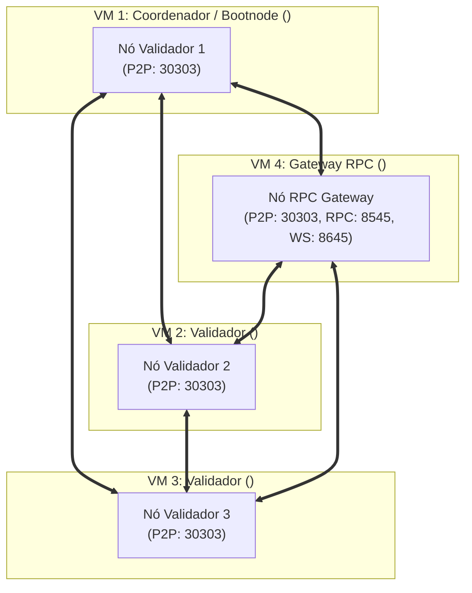

# Laboratório Hyperledger Besu QBFT: Instalação Passo a Passo em Múltiplas Máquinas (lab-multi-node)

> [!NOTE]
> Este guia orienta a implantação e operação da rede privada Hyperledger Besu (QBFT) em **4 máquinas virtuais (VMs) independentes**, utilizando scripts modulares (`.sh`) para cada etapa e máquina do processo — seguindo o modelo operacional do projeto **Ilíada (RNP / cenarios-bevel)**.
> O fluxo é dividido de forma limpa e sequencial: após executar a etapa correspondente em uma máquina, avança-se para a próxima VM utilizando os scripts auxiliares dedicados.

> [!TIP]
> **Substituição Rápida de IPs (Ctrl + F):**
> Utilize a ferramenta de busca e substituição do seu editor para preencher os placeholders com os dados reais da sua infraestrutura:
> - `<node1-ip>` : Endereço IP da **VM 1** (Coordenadora / Bootnode + Validador 1)
> - `<node2-ip>` : Endereço IP da **VM 2** (Validador 2)
> - `<node3-ip>` : Endereço IP da **VM 3** (Validador 3)
> - `<rpc-ip>` : Endereço IP da **VM 4** (Gateway RPC / Consultas e Aplicações Externas)
> - `<usuario>` : Nome do usuário SSH com privilégios de execução nas máquinas

---

## 1. Topologia da Rede Distribuída (4 VMs)

A arquitetura distribui o consenso bizantino **QBFT** entre 3 nós validadores e isola o acesso externo em um gateway RPC dedicado:

| Máquina | Papel no Consenso | Host / IP | Portas Expostas | Finalidade |
| :--- | :--- | :--- | :--- | :--- |
| **VM 1** | **Coordenador + Validador 1 (Bootnode)** | `<node1-ip>` | `30303` (P2P), `8545` (RPC Local) | Descoberta P2P e proposta/assinatura de blocos |
| **VM 2** | **Validador 2** | `<node2-ip>` | `30303` (P2P), `8545` (RPC Local) | Assinatura e consenso QBFT |
| **VM 3** | **Validador 3** | `<node3-ip>` | `30303` (P2P), `8545` (RPC Local) | Assinatura e consenso QBFT |
| **VM 4** | **Gateway RPC / Membro** | `<rpc-ip>` | `30303` (P2P), `8545` (HTTP Público), `8645` (WS) | Interface Web3 para DApps, MetaMask e testes de carga |



---

## 2. Passo a Passo de Execução

### Etapa 1: Em Todas as Máquinas (VM 1 a VM 4) — Pré-requisitos e Firewall

Em cada uma das 4 VMs, instale o Docker e Docker Compose:
```bash
# Caso precise instalar o Docker, execute o utilitário:
./scripts/install-docker.sh
```

Liberar tráfego nas regras de firewall (UFW):
* **Em todas as 4 VMs (P2P Discovery e Sincronização)**:
  ```bash
  sudo ufw allow 30303/tcp
  sudo ufw allow 30303/udp
  ```
* **Apenas na VM 4 (Gateway de API RPC e WebSockets)**:
  ```bash
  sudo ufw allow 8545/tcp
  sudo ufw allow 8645/tcp
  ```

---

### Etapa 2: Na VM 1 (Coordenadora / Bootnode + Validador 1)

Acesse a **VM 1**:
```bash
ssh <usuario>@<node1-ip>
cd facicoin/rede/lab-multi-node
```

#### 2.1. Configurar e Iniciar a VM 1
Execute o script de setup da coordenadora informando o IP público ou acessível da VM 1:
```bash
./02-setup-vm1-coordinator.sh --bootnode-ip <node1-ip>
```
* **O que este script executa:**
  1. Gera as chaves criptográficas para os 3 validadores via contêiner oficial do Besu.
  2. Gera o bloco gênese `genesis.json` (Chain ID `381660001`, tempo de bloco de 2 segundos, política de taxa zero).
  3. Gera o arquivo de allowlist `permissions_config.toml`.
  4. Constrói os pacotes autônomos em `dist/`: `node2.tar.gz`, `node3.tar.gz` e `rpc-node.tar.gz`.
  5. Inicia o contêiner `besu-node1` e executa a verificação de saúde inicial.

#### 2.2. Transferir os Pacotes para as Outras Máquinas
Transfira os pacotes para as VMs remotas via SCP utilizando o script auxiliar:
```bash
./03-transfer-to-vms.sh --node2-ip <node2-ip> --node3-ip <node3-ip> --rpc-ip <rpc-ip> --user <usuario>
```
*O script transfere `node2.tar.gz` e `setup-validator.sh` para a VM 2, `node3.tar.gz` e `setup-validator.sh` para a VM 3, e `rpc-node.tar.gz` com `setup-rpc.sh` para a VM 4.*

---

### Etapa 3: Na VM 2 (Validador 2)

Acesse a **VM 2**:
```bash
ssh <usuario>@<node2-ip>
```

Execute o script de inicialização do Validador 2:
```bash
./setup-validator.sh node2.tar.gz
```
*(Alternativamente, descompacte e inicie via: `tar -xzf node2.tar.gz && cd node2 && ./run.sh && ./check.sh`)*.

* **O que acontece:** O contêiner `besu-node2` inicia e conecta-se automaticamente ao Bootnode (`<node1-ip>:30303`).

---

### Etapa 4: Na VM 3 (Validador 3) — Ativação do Quorum QBFT

Acesse a **VM 3**:
```bash
ssh <usuario>@<node3-ip>
```

Execute o script de inicialização do Validador 3:
```bash
./setup-validator.sh node3.tar.gz
```
*(Alternativamente: `tar -xzf node3.tar.gz && cd node3 && ./run.sh && ./check.sh`)*.

> [!IMPORTANT]
> **Quorum QBFT Atingido:**
> Com a conexão do Validador 3, a rede atinge a maioria qualificada ($2F + 1$) do consenso QBFT. A partir deste momento, as VMs 1, 2 e 3 começam a propor e assinar blocos continuamente a cada 2 segundos!

---

### Etapa 5: Na VM 4 (Gateway RPC / Membro)

Acesse a **VM 4**:
```bash
ssh <usuario>@<rpc-ip>
```

Execute o script de inicialização do Gateway RPC:
```bash
./setup-rpc.sh rpc-node.tar.gz
```
*(Alternativamente: `tar -xzf rpc-node.tar.gz && cd rpc-node && ./run.sh && ./check.sh`)*.

* **O que acontece:** O nó RPC conecta-se aos 3 validadores, sincroniza a cadeia de blocos e expõe a interface Web3 pública na porta **`8545`** (HTTP) e **`8645`** (WebSockets).

---

### Etapa 6: Diagnóstico e Validação Remota

A partir de qualquer computador na mesma rede (ou da própria VM 1):
```bash
cd facicoin/rede/lab-multi-node
./04-check-network.sh --rpc-ip <rpc-ip>
```

Ou execute consultas diretas via `curl`:
```bash
# Consultar bloco atual (deve avançar a cada 2 segundos)
curl -s -X POST --data '{"jsonrpc":"2.0","method":"eth_blockNumber","params":[],"id":1}' \
  -H "Content-Type: application/json" http://<rpc-ip>:8545

# Consultar validadores ativos
curl -s -X POST --data '{"jsonrpc":"2.0","method":"qbft_getValidatorsByBlockNumber","params":["latest"],"id":1}' \
  -H "Content-Type: application/json" http://<rpc-ip>:8545
```

---

### Etapa 7: Comandos de Operação e Manutenção Diária

Em qualquer uma das máquinas, os nós possuem scripts padronizados de gestão:

| Comando | Descrição |
| :--- | :--- |
| `./run.sh` | Inicia o nó via `docker compose up -d` |
| `./check.sh` | Executa diagnóstico de status, peers e bloco |
| `./stop.sh` | Para e remove o contêiner de forma limpa (`docker compose down`) |
| `docker compose logs -f` | Exibe o stream de logs do Besu em tempo real |
